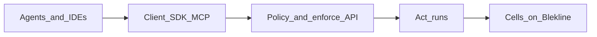

<!-- GitHub repo About field: Execution platform clients — connect agents, publish policy, start act runs; cells run on Blekline. -->
<!-- Social preview / Open Graph: assets/images/blekline-oss-og.png — also upload in GitHub Settings → General → Social preview -->
<div align="center">
<picture>
<source media="(prefers-color-scheme: light)" srcset="assets/images/blekline-logo-light.svg"/>

</picture>
</div>
<p align="center">
  <a href="https://app.blekline.com/docs">Docs</a> ·
  <a href="https://app.blekline.com/docs/workflows-and-runs">First workflow run</a> ·
  <a href="https://app.blekline.com/auth/signup">Cloud</a>
</p>

<p align="center">
  <a href="https://github.com/Blekline/blekline-oss/actions/workflows/oss-ci.yml"></a>
  <a href="https://www.npmjs.com/package/@blekline/init"></a>
  <a href="https://www.npmjs.com/package/@blekline/client"></a>
  <a href="https://www.npmjs.com/package/@blekline/mcp-server"></a>
  <a href="LICENSE"></a>
  <a href="LICENSE-APACHE"></a>
</p>

---

**Blekline** is execution infrastructure for AI actions: workflows, published runtime policy, and **act runs** in cells. This repository ships **official clients, contracts, and agent ingress**. **Cells run on [app.blekline.com](https://app.blekline.com)** (hosted or connected compute), not from this repo.

**Not a sandbox SDK:** `@blekline/client` governs policy, mask, and runs against the control plane. It does not execute arbitrary code in a remote sandbox. See [examples/](examples/README.md) for integration patterns.

## Quick start — first act run (60 seconds)

No clone. [Create a workspace](https://app.blekline.com/auth/signup), create an API key with **runs:write** ([API keys](https://app.blekline.com/api-keys) · [docs](https://app.blekline.com/docs/build/endpoints-and-keys)), publish [runtime policy](https://app.blekline.com/docs/runtime-policy), then:

```bash
npx -y @blekline/init
export BLEKLINE_WORKSPACE_TOKEN="blw_..."
export BLEKLINE_API_URL="https://app.blekline.com"
export BLEKLINE_WORKFLOW_ID="wf_your_workflow_id"
node examples/cells/first-act-run/index.mjs
```

Guide: [Run first workflow](https://app.blekline.com/docs/workflows-and-runs) · SDK: [@blekline/client](https://app.blekline.com/docs/sdk-client)

```ts
import { BleklineClient } from "@blekline/client";

const client = new BleklineClient({
  workspaceToken: process.env.BLEKLINE_WORKSPACE_TOKEN!,
  metadata: { clientSurface: "sdk" },
});

const { run } = await client.createCellRun({
  workflowId: "wf_your_workflow_id",
  executionTier: "act",
  toolCall: true,
});
console.log(run.id, run.compileHash, run.status);
```

## Architecture



## Packages

### Start here (Apache-2.0)

| Package | Install | Role |
| ------- | ------- | ---- |
| `@blekline/init` | `npx @blekline/init` | Detect clients, write `.blekline/policy.json`, print Platform path |
| `@blekline/client` | `npm i @blekline/client` | Control plane: policy, runs, mask, enforce |
| `blekline-client` (PyPI) | `pip install blekline-client` | Python SDK (same API shapes) |

### Contracts (Apache-2.0)

| Package | Role |
| ------- | ---- |
| `@blekline/contracts` | Policy schemas, OpenAPI types, local enforce helpers |

OpenAPI: [packages/contracts/openapi.yaml](packages/contracts/openapi.yaml). **Semver:** additive changes only in minor releases; breaking API changes require a major bump and CHANGELOG entry.

### Framework helpers (Apache-2.0)

| Package | Role |
| ------- | ---- |
| `@blekline/langchain` / `@blekline/llamaindex` | Tool-boundary guards |
| `@blekline/claude-sdk` | Claude ingress helpers |

### Ingress (AGPL-3.0)

| Package | Install | Role |
| ------- | ------- | ---- |
| `@blekline/mcp-server` | `npx -y @blekline/mcp-server` | Stdio MCP governance tools |
| `@blekline/mcp-proxy` | `npm i @blekline/mcp-proxy` | Downstream MCP policy proxy |
| `@blekline/cursor-hooks` / `@blekline/codex-hooks` | npm | IDE ingress |
| `@blekline/client-hooks` | workspace | Shared hook utilities |

MCP tools: `blekline_mask_prompt` · `blekline_evaluate_tool_call` · `blekline_simulate_policy` · [MCP server docs](https://app.blekline.com/docs/reference/mcp)

### Optional posture (AGPL-3.0)

| Package | Role |
| ------- | ---- |
| `@blekline/cluster-posture` | Static K8s scan before [spin up cells](https://app.blekline.com/docs/spin-up-cells) |

## Examples

Category index: [examples/README.md](examples/README.md) (cells, ingress, model providers, frameworks, agents, CI). Mistral and Fireworks samples are required integration examples.

`npx @blekline/init --example mistral` prints the path from [integrations/manifest.json](integrations/manifest.json).

## Connect agents (door 2)

[Connect agents and clients](https://app.blekline.com/docs/connect-clients) — Cursor, Claude Code, Codex, Copilot, and CI.

| Surface | Path | `BLEKLINE_CLIENT_SURFACE` |
| ------- | ---- | ------------------------- |
| Init | `npx @blekline/init` | per client |
| CLI / SDK | [cli/](cli/) | `sdk` |
| CI | [ci/](ci/) | `sdk` |
| Cursor | [.cursor/mcp.json.example](.cursor/mcp.json.example) | `cursor` |
| Claude Code | [.claude/settings.json.example](.claude/settings.json.example) | `claude-code` |

Full matrix: [integrations/README.md](integrations/README.md) · `pnpm verify:integrations`

## Open source vs hosted

| This repository | [app.blekline.com](https://app.blekline.com) |
| --------------- | -------------------------------------------- |
| Clients, contracts, MCP/hooks, reference ingress-proxy | Workflows, runs UI, audit store, billing |
| Local policy dev and CI simulation | **Publish** runtime policy, `compileHash` at run birth |
| Optional cluster posture scan (no account) | Compute, cell profiles, connected clusters |

Production sidecar images and runtime enforcement engines are **not** built from this repository. Reference only: [ingress-proxy/README.md](packages/ingress-proxy/README.md).

## Optional — cluster posture (Kubernetes)

Static scan for agent workloads and enforcement hops **before** you [spin up cells](https://app.blekline.com/docs/spin-up-cells) on connected compute. No Blekline account required.

```bash
kubectl apply -f https://raw.githubusercontent.com/Blekline/blekline-oss/main/packages/cluster-posture/deploy/rbac/cluster-posture-reader-namespaced.yaml -n posture-eval
kubectl apply -f https://raw.githubusercontent.com/Blekline/blekline-oss/main/packages/cluster-posture/deploy/rbac/cluster-posture-reader-cluster.yaml
npx @blekline/cluster-posture audit --profile generic --namespace posture-eval --plain --json -o cluster-posture.json
```

[Operate: security](https://app.blekline.com/docs/operate/security) · [CI gate example](ci/github-actions/cluster-posture/)

## Documentation

| Topic | Link |
| ----- | ---- |
| Overview | [app.blekline.com/docs](https://app.blekline.com/docs) |
| Workflows and runs | [workflows-and-runs](https://app.blekline.com/docs/workflows-and-runs) |
| Runtime policy | [runtime-policy](https://app.blekline.com/docs/runtime-policy) |
| Spin up cells | [spin-up-cells](https://app.blekline.com/docs/spin-up-cells) |
| SDK client | [sdk-client](https://app.blekline.com/docs/sdk-client) |
| Glossary | [definitions](https://app.blekline.com/docs/definitions) |

## Community

- **Questions** — [GitHub Discussions](https://github.com/Blekline/blekline-oss/discussions)
- **Design partners** — [design partner issue](https://github.com/Blekline/blekline-oss/issues/new?template=design_partner.yml)
- **Security** — [SECURITY.md](SECURITY.md)

[CONTRIBUTING.md](CONTRIBUTING.md) · [CHANGELOG.md](CHANGELOG.md)

Private team: develop in the `blekline` monorepo → `pnpm audit:oss-public && pnpm sync:oss`.

## License

| Component | License |
| --------- | ------- |
| `mcp-server`, `mcp-proxy`, `ingress-proxy`, `cluster-posture`, `cursor-hooks`, `codex-hooks` | [AGPL-3.0](LICENSE) |
| `contracts`, `client`, `client-python`, `client-hooks`, `claude-sdk`, `init`, `langchain`, `llamaindex` | [Apache-2.0](LICENSE-APACHE) |

Managed SaaS and production runtime images are offered at [app.blekline.com](https://app.blekline.com) under separate terms.
